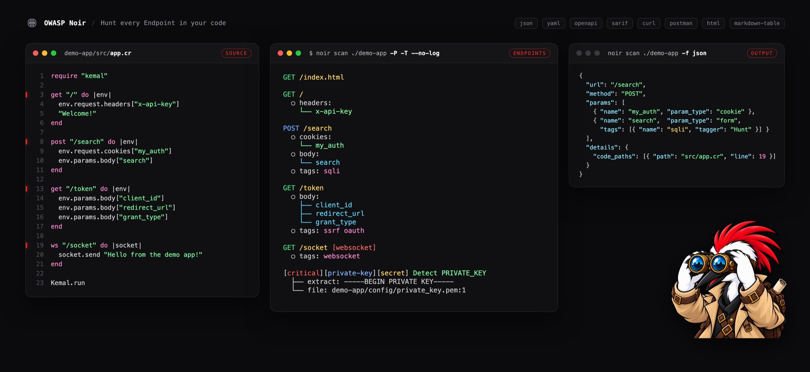

---

layout: col-sidebar
title: OWASP Noir
tags: noir owasp-noir sast dast ai-sast llm attack-surface endpoint shadow-api
level: 2
type: code
pitch: Hunt every Endpoint in your code, expose Shadow APIs, map the Attack Surface.

---

<div align="center">
  
  <p>Hunt every Endpoint in your code, expose Shadow APIs, map the Attack Surface.</p>
</div>

<p align="center">
<a href="https://github.com/owasp-noir/noir/releases">
</a>
<a href="https://crystal-lang.org">
</a>
<a href="https://owasp.org/www-project-noir/">
</a>
<a href="https://www.bestpractices.dev/projects/14203">
</a>
<a href="https://github.com/owasp-noir/noir/blob/main/.github/CONTRIBUTING.md">
</a>
</p>

<hr>

Noir is a SAST tool that reads source code and lists the endpoints an application exposes: paths, methods, parameters, headers, cookies, and the source files behind them. Shadow APIs, deprecated routes, and undocumented handlers are in the same inventory.

The inventory has three readers:

- **Human reviewers** start from attacker-reachable entry points instead of the whole repo.
- **AI auditors** get the same list plus per-endpoint review context (`--include callee`, `--ai-context`).
- **DAST tools** (ZAP, Burp Suite, Caido, Gori) get routes a crawler would never reach.

For more information, please visit our [documentation page](https://owasp-noir.github.io/noir/).



## What Noir does

- **Endpoint extraction.** Static analysis across [264 frameworks](https://owasp-noir.github.io/noir/usage/supported/language_and_frameworks/).
- **LLM fallback.** OpenAI, Ollama, and other providers cover frameworks the static rules don't.
- **Output formats.** JSON, YAML, OpenAPI, SARIF, cURL, Postman, HTML, and more.
- **DAST integration.** Send endpoints to ZAP, Burp Suite, Caido, or Gori through a proxy, or export OpenAPI.
- **AI review context.** `--include callee` adds the functions each handler calls; `--ai-context` adds guards, sources, sinks, validators, and signals.
- **CI/CD.** GitHub Action, SARIF output, and exit codes.

## Get started

```bash
brew install noir
noir scan <source_dir>
```

Snap, Docker, npm, Nix and packages are on the [Installation](https://owasp-noir.github.io/noir/get_started/installation/) page.

## Road Map

Noir started as a way to hand DAST tools the routes found in source code. The same inventory now serves human reviewers and AI auditors too, and the roadmap treats all three equally:

- Broaden language and framework coverage, with per-framework fixtures to check accuracy.
- Use LLMs where static analysis can't reach.
- Enrich the per-endpoint review context (guards, callees, sinks, validators, signals).
- Keep DAST integration first-class: OpenAPI, proxy targets, and hand-offs to ZAP, Burp Suite, Caido, and Gori.

<style>
  .sub-nav{
    display: none !important;
  }
</style>
